# DNT-Scout

**Which untested chemicals deserve a microelectrode-array run — and when is the structural evidence too thin to say?**

From a chemical structure alone, DNT-Scout ranks compounds by how likely they are to *selectively*
disrupt the formation of neuronal networks in development, attaches a calibrated statement of
confidence to each prediction, and refuses to answer when the chemistry is outside what it has
evidence for. It is a triage tool for a laboratory queue, not a safety verdict.

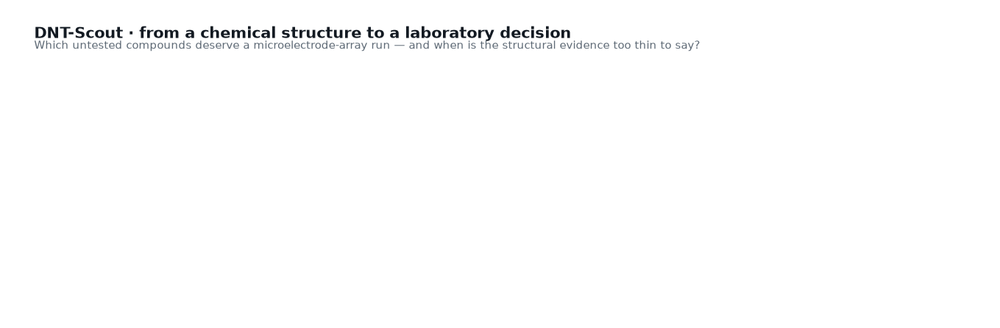

### ▶ Watch the film — 3 min 17 s

[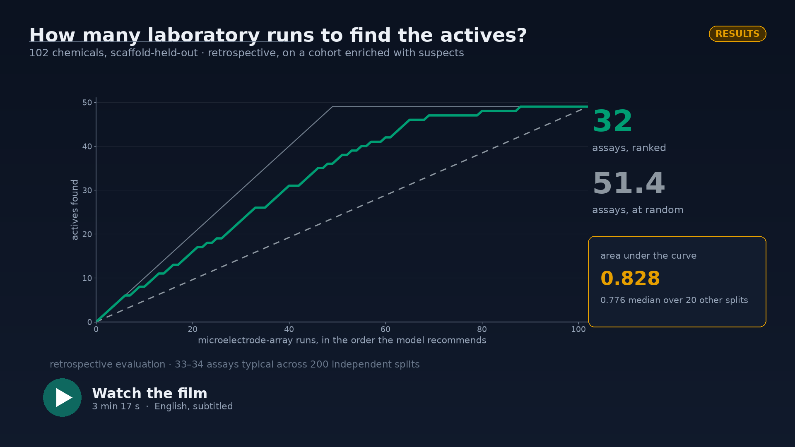](https://www.youtube.com/watch?v=uJkbKtojOMc)

A short documentary on the question, the result and its limits, with the SciencePal agent running
on screen. Every number in it is read from a file in this repository and logged, with its source,
to [`video/numbers_onscreen.json`](video/numbers_onscreen.json) — and the film is built from this
repository too, by [`video/tools/`](video/tools).

<table>
<tr><td><b>Headline</b></td><td><b>32</b> microelectrode-array runs instead of <b>51.5</b> to find half the selectively active compounds — about a third of the laboratory work removed, and 33–34 runs typically across 200 independent splits.</td></tr>
<tr><td><b>Data</b></td><td>136 chemicals from the US EPA network-formation assay (Shafer et al. 2019), public domain, re-downloaded from source.</td></tr>
<tr><td><b>Validation</b></td><td>Scaffold- and cluster-held-out cross-validation, a similarity cap that rules out memorised near-duplicates, and an independent audit whose <b>999-permutation test gives p = 0.001</b>.</td></tr>
<tr><td><b>Uncertainty</b></td><td>Mondrian conformal prediction at a nominal 90%; measured coverage 89.2% for the structural forest, 94.1% for the portable read-across. The tool abstains on 63% of queries and says so.</td></tr>
<tr><td><b>Licence</b></td><td>MIT (code) · the underlying EPA data are US Government work, public domain.</td></tr>
</table>

Built for the **2026 Global AI4Science Hackathon** (SciencePal × CityUHK × Tencent Cloud).
Everything here is new work created during the event — see [Resource declaration](#resource-declaration).

---

**Contents** — [1 · The problem](#1--the-problem) · [Background](#background) · [2 · What counts as a hit](#2--what-counts-as-a-hit) · [3 · The result](#3--the-result) · [4 · Is the result real?](#4--is-the-result-real) · [5 · Saying "I don't know"](#5--saying-i-dont-know) · [6 · Scope, and what is outside it](#6--scope-and-what-is-outside-it) · [7 · The decision, on chemicals nobody has seen](#7--the-decision-on-chemicals-nobody-has-seen) · [8 · Reproduce it](#8--reproduce-it) · [9 · Method, in one paragraph](#9--method-in-one-paragraph) · [10 · Limitations](#10--limitations) · [Real-world applications](#real-world-applications) · [Possible improvements](#possible-improvements) · [Future work](#future-work) · [Resource declaration](#resource-declaration) · [Citation and licence](#citation-and-licence) · [Bibliography](#bibliography)

## 1 · The problem

<p align="center">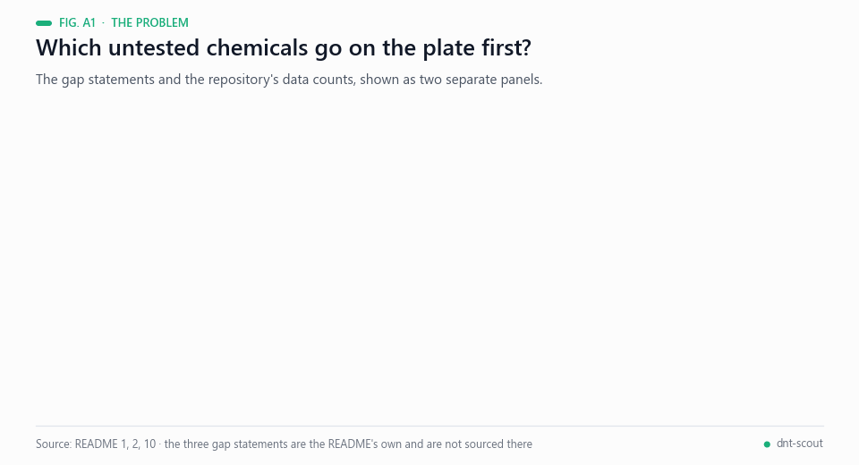<br><sub>Animated figure A1 — The gap and the data, with counts as stated in this README.</sub></p>

Developmental neurotoxicity is among the most expensive endpoints in regulatory toxicology and one
of the least covered: of the tens of thousands of chemicals in commerce, a few hundred have been
through a developmental-neurotoxicity battery. The *in vitro* alternative — growing cortical
neurons on a microelectrode array and watching whether they organise into a firing network — is
faster than an animal study but still costs days of culture per compound. With the US EPA planning
to phase out mammalian testing, the binding question becomes a scheduling question: **of the
compounds nobody has tested, which ones go on the plate first?**

That question has a precise, checkable answer: *how many assays do you have to run to find the
actives?* It is the question this repository answers.

## Background

<p align="center">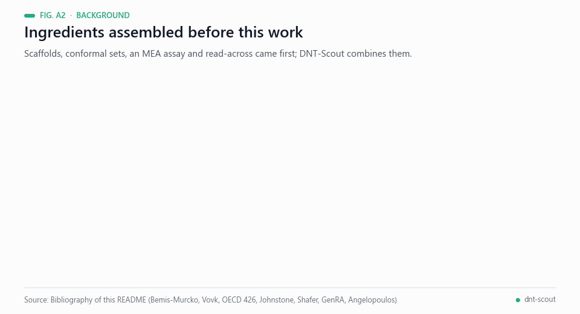<br><sub>Animated figure A2 — Ingredients assembled before this work. Sources: bibliography below.</sub></p>

DNT-Scout combines four ingredients that each have their own history. The data are the network-formation recordings
of Shafer et al., in which rat cortical neurons are grown on microelectrode arrays and a chemical is judged by whether
the culture still organises into a firing network [[1](#ref-1), [2](#ref-2)]; arrays had been proposed as a neurotoxicity
testing platform a decade earlier [[3](#ref-3)], against the background of the in vivo developmental neurotoxicity
study described in OECD Test Guideline 426 [[4](#ref-4)]. The modelling side rests on Bemis-Murcko molecular frameworks,
used here to keep chemicals that share a scaffold in the same fold [[5](#ref-5)], on Butina clustering for the harder
split [[6](#ref-6)], and on circular fingerprints and MACCS keys as representations [[7](#ref-7), [8](#ref-8)]. The prediction
that gives the headline result is read-across, the logic behind the US EPA GenRA workflow [[9](#ref-9)], implemented with
RDKit and scikit-learn [[10](#ref-10), [11](#ref-11)].

The statement of confidence comes from conformal prediction, which turns a score into a prediction set with a
coverage target [[12](#ref-12)]. The class-conditional (Mondrian) form used here asks for the target within each outcome
class rather than on average [[13](#ref-13)], and a recent tutorial describes the framework and its assumptions
[[14](#ref-14)]. Section 5 of this README measures, rather than assumes, how close the sets come to their nominal 90 %,
and the independent audit tests significance with a permutation scheme that refits the whole procedure
[[15](#ref-15)].

The author has published related work in the same style of reporting, with pre-registered or audited evaluations and
separate declaration of what each result does not show:
[`egp-clinical-shield`](https://github.com/Agnuxo1/egp-clinical-shield) (a pre-registered evaluation of an
on-device privacy layer for clinical notes) and
[`enveda-casmi-2026-metfrag-ranking`](https://github.com/Agnuxo1/enveda-casmi-2026-metfrag-ranking) (a
structure-ranking entry for a mass-spectrometry challenge). DNT-Scout is a clean-room project: as the
[Resource declaration](#resource-declaration) states, nothing from the author's separate
[`neurochip-twin`](https://github.com/Agnuxo1/neurochip-twin) work is used here, and the repositories above are listed
as context, not as dependencies.

## 2 · What counts as a hit

A chemical that kills the culture flattens every electrophysiological parameter. Counting that as
"neuroactive" is the main way a developmental-neurotoxicity screen fools itself, so the outcome
used throughout is defined **against viability**, and the ambiguous cases stay visible instead of
being quietly folded into the negative class.


| Class | n | Used as |
|---|---|---|
| Selective effect on network formation | 49 | positive |
| No effect observed in the tested range | 53 | negative |
| Network effect only at cytotoxic concentrations | 28 | **reported, never a negative** |
| Structure not modellable (mixture, inorganic, unresolved) | 6 | **reported** |

**Credit where it is due.** The selectivity *ratio* is not ours: Shafer et al. publish a
per-compound "Selectivity Score" which is exactly this quantity. Recomputing it here from the raw
EC50 tables reproduces their published values — Pearson r = 0.9995 on log₁₀ across the 39 compounds
that match by name, with o,p'-DDT at 244.398 in both. We use that agreement as a check that the
data pipeline is right, not as a result. **What is ours** is turning the ratio into a binary
outcome, keeping the chemicals it cannot classify in their own visible classes, and building a
triage decision on top.

**What "no cytotoxicity" really means.** 27 of the 49 positives have no fitted cytotoxicity EC50 at
all, so for them the ≥3× rule was never the binding test. That is not the end of the matter: the
top tested concentration is 20 µM throughout, which puts a *lower bound* on each ratio. **18 of the
27 clear 3× on that bound**, so their selectivity is supported inside the tested range whatever the
missing value would have been. The remaining **9 are genuinely indeterminate** — their network EC50
sits at 7–18 µM, too close to the top dose to bound anything — and §4 re-runs the whole evaluation
with those 9 removed. The other 22 positives clear the threshold by a directly measured margin
(median 6.5×), and [the model finds both kinds](#4--is-the-result-real) (ROC 0.854 and 0.806
against the negatives). Finally, the threshold is a choice, so the class counts at 1×, 3× and 10×
are published together: 70 · 49 · 35.

## 3 · The result

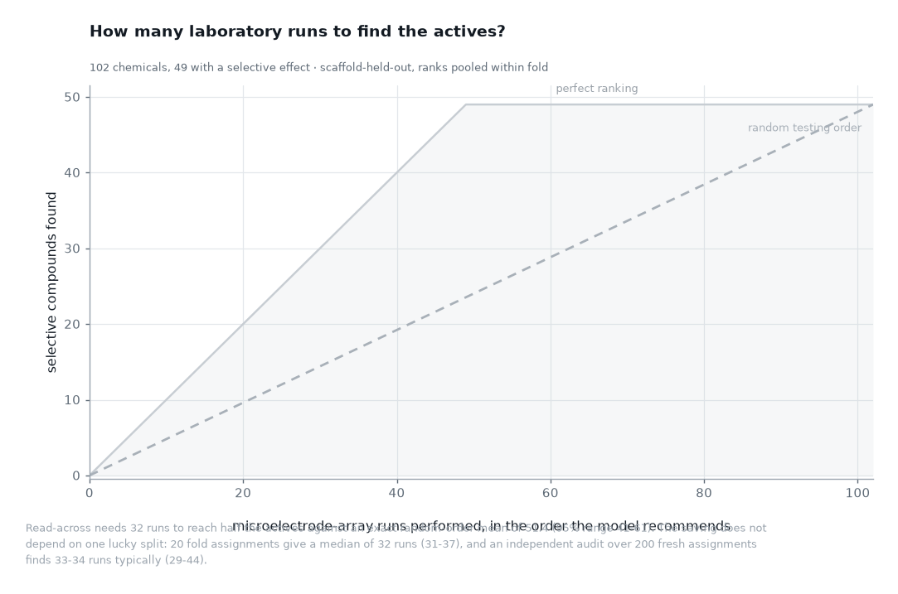

Testing in the order the model recommends, **half the selective compounds are found after 32
assays**. Testing in a random order takes 52 (51.4 on average, 95% range 41–61). A perfect oracle
would need 25, so the ranking captures about three quarters of the gain that is available at all.

| Model | ROC AUC | PR AUC | Assays for half the actives |
|---|---|---|---|
| Chance (control) | **0.500** | 0.480 | 52 |
| Physicochemical descriptors | 0.750 | 0.635 | 36 |
| **Read-across from measured analogues** | **0.828** | **0.780** | **32** |
| Structural random forest | 0.766 | 0.674 | 36 |

Single pre-declared split (seed 20261023). The chance control sits at exactly 0.500 by
construction — see [the note on pooling](#a-note-on-pooling-across-folds), which is a real
methodological trap this project walked into and climbed out of.

## 4 · Is the result real?

Three independent attempts to break it. None of them does, and the exercise sharpened what can
honestly be claimed.


**One split is not evidence.** Repeating the entire evaluation over 20 fold assignments gives a
median ROC of **0.776 (0.703–0.828)** for read-across; the pre-declared split landed at the
optimistic end of that range. An [independent audit](#independent-audit) went further, with 200
fresh assignments: median ROC **0.760** under the same grouping rule, and **0.744** when the groups
are formed without looking at the labels at all — the most conservative number this result has.
The practical figure moves less: **33–34 assays typically** (29–44 across 200 splits; 32 on the
pre-declared split) against an exact random-order mean of **51.5 (95% range 41–62)**.

**Is it memorising close relatives?** Read-across is a weighted vote of measured analogues, so the
obvious worry is that it recognises near-duplicates rather than generalising. Hiding every training
analogue above a similarity cap answers it: at a cap of 0.7, ROC 0.820; at 0.5, ROC 0.799. There
was little to memorise in any case — the median nearest-analogue similarity across the set is 0.36,
and only 4% of chemicals have an analogue above 0.9. The structural forest ignores the similarity
matrix entirely and is flat across the cap, which is the internal control this panel needs.

**A harder split.** 73 of the 81 Bemis-Murcko scaffold groups contain a single chemical — 90% of
the groups, which is 72% of the chemicals — so scaffold-held-out is close to leave-one-out and is
not the structural-novelty test its name suggests. Holding out whole Butina clusters at 0.6 similarity is harder, and performance falls to
0.74–0.77 — still far above chance, but with the three model families converging. **Read-across
being the best model is specific to the scaffold split; structure carrying real signal is not.**

**The strictest possible endpoint.** The sharpest objection to this work is the 9 positives whose
selectivity ratio cannot be bounded above 3× (§2). So the whole evaluation was re-run without them
— and the result **improves**:

| | as published (102 chemicals) | strict (93, the 9 removed) |
|---|---|---|
| Read-across ROC AUC | 0.779 (0.695–0.828) | **0.832 (0.790–0.877)** |
| Structural forest ROC AUC | 0.757 | **0.839 (0.823–0.871)** |
| Assays for half the actives | 32 vs 51.4 at random | **25 vs 45.8** — a 45% saving |

Those nine were *diluting* the signal, not creating it. The headline does not depend on the
positives that are hardest to defend; it is stronger without them. (Under the strict endpoint the
structural forest edges ahead of read-across, with overlapping intervals — another reminder that
which model wins is not the robust part of this result.)

### Independent audit

On 2026-10-23 this project was audited by a **separate agent that did not share our code**, working
from the frozen commit `38b00be` with its own protocol and seeds fixed before anything was run. It
is the strongest evidence here, so it is reported in full rather than summarised away.

<p align="center">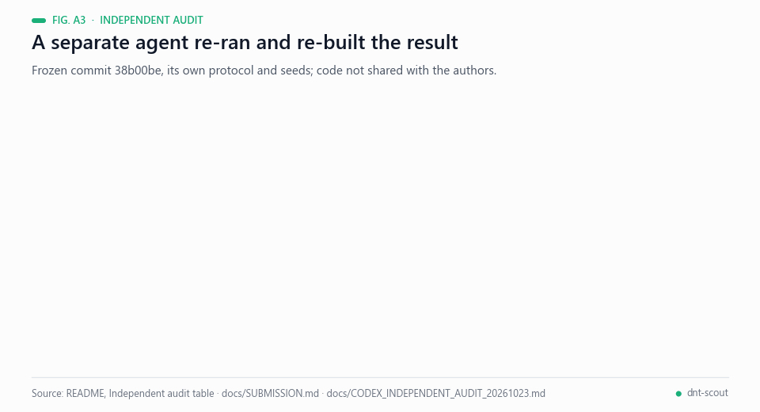<br><sub>Animated figure A3 — What the separate audit reproduced and re-built. Data: the table below, docs/SUBMISSION.md and docs/CODEX_INDEPENDENT_AUDIT_20261023.md.</sub></p>

| What it did | What it found |
|---|---|
| Reproduced the evaluation in an isolated copy | **All 185 numeric fields match** |
| Re-implemented read-across, grouping and nested selection from scratch | Predictions agree to **5.55 × 10⁻¹⁷** |
| Rebuilt the labels independently from the EPA Excel | **136 / 136 identical**; the three input SHA256 match |
| **999 label permutations between equal-size scaffolds, refitting folds, inner selection and predictions each time** | **None reaches the observed AUC. p = 0.001** (p = 0.003 for the assay budget; p = 0.004 Bonferroni-corrected across the four model families) |
| Exact random-order distribution, no Monte Carlo | mean **51.5**, exact 95% interval **41–62**; the chance of ≥25 positives in 32 random picks is **3.68 × 10⁻⁵** |
| 10,000 random tie-breaks | the budget stays at **32** — not an artefact of row order |
| 200 fresh fold assignments | median ROC **0.760** (original grouping rule) and **0.744** (groups formed without looking at labels) |
| The test suite | **23 / 23 pass** |

<p align="center">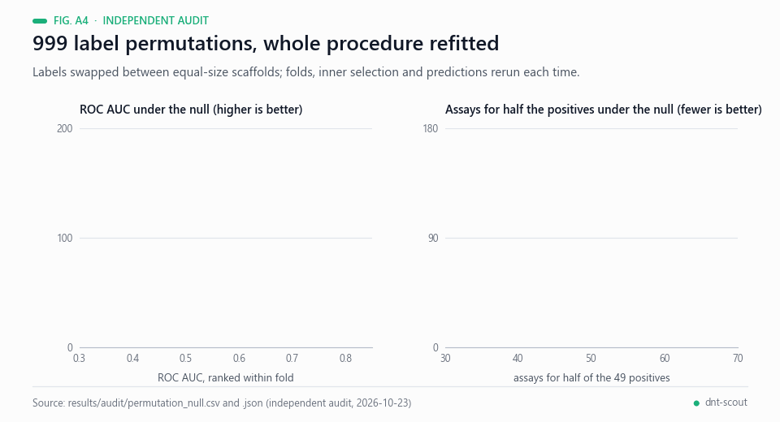<br><sub>Animated figure A4 — The 999-permutation null for ROC AUC and for the assay budget. Data: results/audit/permutation_null.csv and .json.</sub></p>

The permutation test is the part that matters most. It does not merely reshuffle predictions: it
re-runs the entire learning procedure — outer folds, inner hyperparameter selection and all — on
999 relabelled datasets that preserve scaffold sizes, within-group correlation and the number of
positives. **The null it rejects is "structure carries no information about this endpoint", and it
rejects it at p = 0.001.**

Its stated limits, which we adopt: the null is conditional on scaffold sizes and on that notion of
exchangeability, so it does not cover every possible biological bias; and 999 permutations of one
cohort are not 999 independent studies. The audit also found the real defects listed above — the
group/chemical denominator confusion, the unlabelled coverage figure, an applicability-domain
threshold computed against one reference and applied against another (94/102 in domain versus
88/102 with a consistent reference), and a salt-versus-mixture policy that differed between the core
library and exported scorer. Both are corrected in the 25 October update; the rerun preserves the
ranking and returns 88/102 in-domain. See [the correction and API ablation audit](docs/AUDIT_UPDATE_20261025.md).

## 5 · Saying "I don't know"

A triage tool that answers every question is not calibrated, it is guessing. Each prediction comes
with a Mondrian (class-conditional) conformal set at a nominal 90% confidence, plus an
applicability-domain check based on similarity to the nearest measured analogue.


Coverage is **measured on held-out scaffolds, not assumed** — and it belongs to a *specific
model*, which is worth saying because the two in this project differ. For the **structural forest**
evaluated here: 89.2% overall against the 90% promised, 87.8% on the selective class and 90.6% on
the no-effect class. For the **portable read-across** that ships in `score_candidates.py`, measured
externally by an independent audit: **94.1%** on the pre-declared split and a median of 95.1% over
20 fresh ones — it over-covers, which is the conservative direction, at the cost of returning more
both-class sets. With 102 held-out chemicals the standard error on a coverage of 0.90 is about 3
points. The honest cost is that the set is uninformative — it contains both outcomes — for 63% of
chemicals, and 13.7% fall outside the applicability domain after the 25 October reference correction. Those are the queries where
the correct output is a shrug, and the tool gives one.

## 6 · Scope, and what is outside it


The 28 chemicals whose network effect appears only at lethal concentrations are excluded from the
primary comparison, and they are not a random 28: they carry 22 scaffolds that then appear nowhere
in the modelled set, and they form a coherent mechanistic family — rotenone, valinomycin,
tributyltin, five strobilurin fungicides, two statins, chlordane, endosulfan, MPP⁺. So the harder
question is asked as well: **selective activity against everything else, cytotoxicants included.**
Read-across scores **0.696 (0.595–0.784)** there, 44 assays against 65.5 at random. Lower, as it
should be, and the interval still excludes chance.

The model does rank many of those cytotoxicants highly, and that is worth reading carefully rather
than as a failure. Permethrin sits at a selectivity ratio of 1.9×, rotenone at 2.1×, oxidopamine at
2.8× — just under the three-fold line. A high score for them is the model correctly recognising
real neuroactive chemistry; what structure alone does not resolve is the fine selectivity margin.
In the EPA protocol viability is read from the same plate, so an assay spent on one of these still
returns a usable answer.

**What this tool is not.** It does not establish that a compound is safe. A negative *in vitro*
result does not exclude developmental neurotoxicity — the OECD guidance says so directly — and
nothing here should be read as a regulatory conclusion. The prevalence in this cohort is 48%
because the EPA deliberately enriched it with suspected actives; the enrichment achievable on an
unselected chemical library is not measured here and would be a different experiment.

## 7 · The decision, on chemicals nobody has seen

Twenty chemicals are drawn from the wider EPA screen and withheld from fitting, selection and
calibration. The task is the one a laboratory actually faces: **name the five to run first, and say
which ones you cannot judge.**

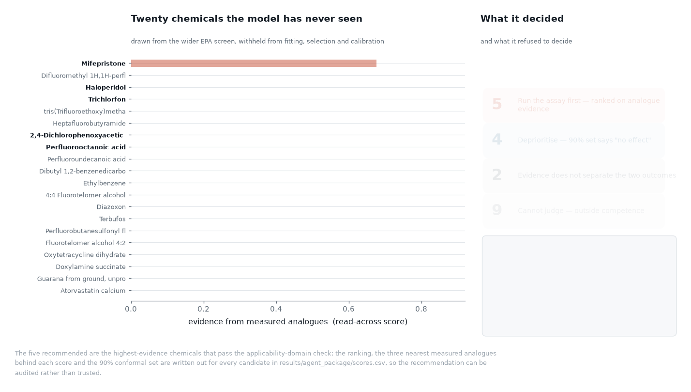

Nine of the twenty come back undecided — four have no single resolvable structure, five are outside
the applicability domain — and none of the five recommended carries a confident positive call
either. They are the chemicals with the strongest analogue evidence, which is what a triage list
is, and the tool reports it that way rather than dressing a ranking up as a prediction. Every score
ships with its three nearest measured analogues and their outcomes, in
[`results/agent_package/scores.csv`](results/agent_package/scores.csv), so the recommendation can
be audited instead of trusted.

### The same task, run inside SciencePal

**Live thread:** https://sciencepal.ai/share/248df9d7-b3aa-4607-8e4c-c4de1a9abc5e

The central step is executed inside the platform, not here: the SciencePal **Biology Agent** is
given the same four files — and deliberately *not* given `scores.csv`, the answer above — then
runs this project's scoring script in its own sandbox, resolves the structures, and writes a triage
report. The pre-declared ablation (ranking alone versus ranking + agent) is in
[`results/sciencepal/ABLATION.md`](results/sciencepal/ABLATION.md), with the agent's verbatim
output in [`AGENT_REPORT.md`](results/sciencepal/AGENT_REPORT.md).

| | ranking alone | ranking + agent |
|---|---|---|
| Candidates resolved to a structure | 16 / 20 | **19 / 20** |
| Chemicals with a decisive 90% conformal set | 0 | **1** |
| Refusals | 9, one bucket | 6, in **three distinct categories** |
| Literature support | none | 4 DOI-cited mechanistic claims |

<p align="center">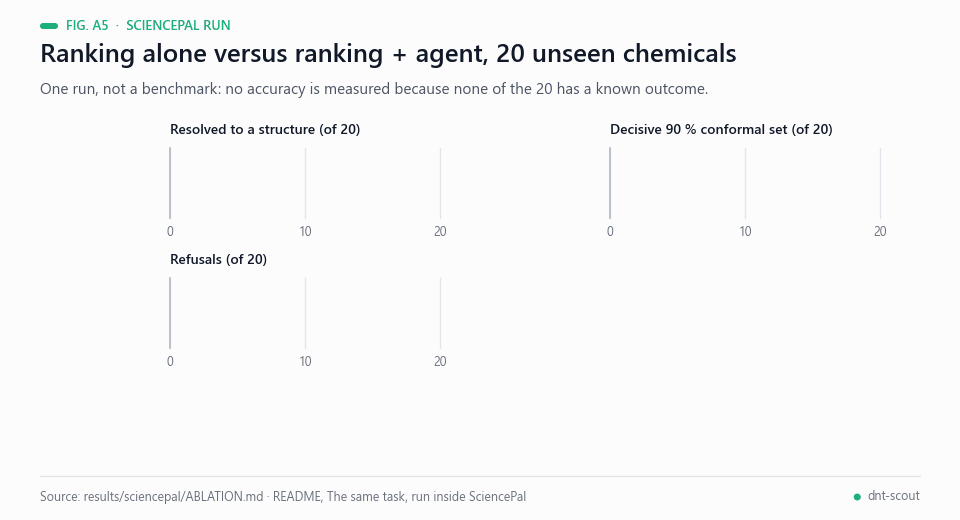<br><sub>Animated figure A5 — Ranking alone versus ranking + agent on 20 unseen chemicals; one run, not a controlled comparison. Data: results/sciencepal/ABLATION.md.</sub></p>

Two things the ranking could not do on its own. PubChem was **IP-blocked** from the SciencePal
sandbox; the agent said so instead of failing quietly, routed around it through NCI CACTUS and the
EPA Substance Registry Service, and so recovered **doxylamine** — a salt the automated pipeline had
discarded, and the only one of the twenty with a decisive conformal set (score 1.000). And it
**overruled the ranking**, dropping oxytetracycline because its nearest measured analogue is
tetracycline at T = 0.50 — the highest similarity anywhere in the candidate set — and tetracycline
shows no effect, so the score was being propped up by two far weaker selective neighbours.

Its three headline numbers were **recomputed here independently** before being reported
([`scripts/verify_agent.py`](scripts/verify_agent.py)) and they reproduce exactly. What the
ablation does *not* establish is set out plainly in `ABLATION.md`: the two arms did not face
identical network conditions, no accuracy was measured because none of the twenty has a known
outcome, and this is one run, not a benchmark.

## 8 · Reproduce it

<p align="center">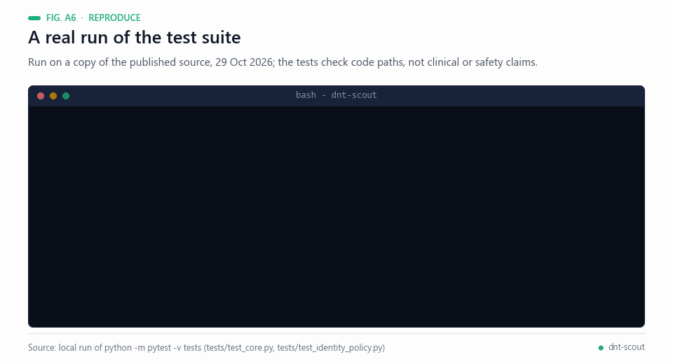<br><sub>Animated figure A6 — A real run of <code>python -m pytest -v tests</code> on a copy of the published source: 31 tests pass (the audit update also reports 31; the count in the comment of the command block above predates it).</sub></p>

```bash
git clone https://github.com/Agnuxo1/dnt-scout && cd dnt-scout
python -m venv .venv && . .venv/bin/activate
pip install -e ".[dev]"

python scripts/01_build_dataset.py      # downloads EPA + PubChem, verifies SHA256
python scripts/02_evaluate.py           # the table in section 3
python scripts/audit_02_validity.py     # the robustness panels in section 4 (~15 min)
python scripts/figures_core.py          # every figure in this README
pytest -q                               # 21 tests
```

Raw data are **not** redistributed here: `01_build_dataset.py` fetches them from the original
sources and checks them against the SHA256 manifest in
[`docs/provenance.json`](docs/provenance.json). Nothing in this repository is downstream of a file
you cannot re-fetch and verify yourself.

### A note on pooling across folds

<p align="center">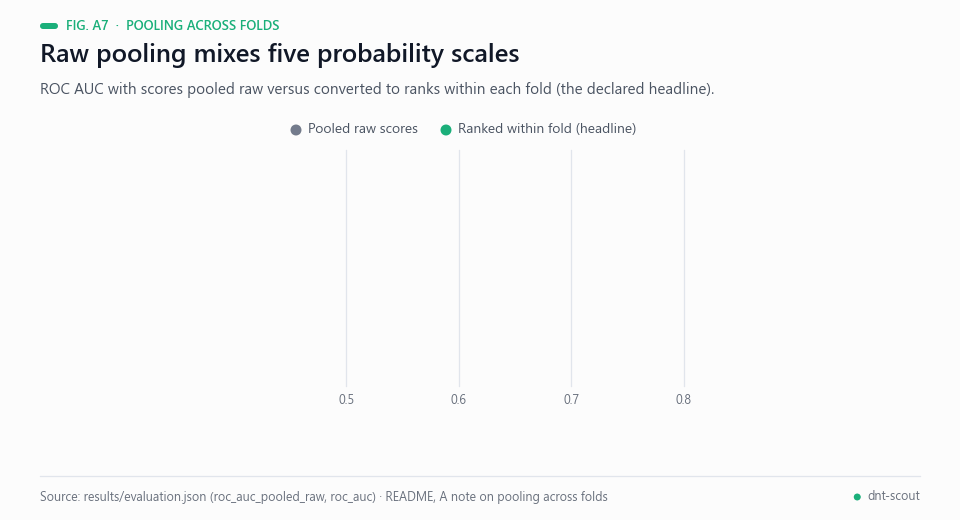<br><sub>Animated figure A7 — Pooled raw versus within-fold-ranked ROC AUC for the four models. Data: results/evaluation.json.</sub></p>

Cross-validation produces one model per fold, and nothing makes five models' probabilities
comparable to each other, so pooling the raw scores into one ranking mixes five scales. The effect
is measurable: the prevalence baseline — a constant per fold, which *must* score chance — comes out
at ROC 0.473 pooled raw, and at exactly 0.500 once each score is converted to its rank within its
own fold.

This project reports the ranked version as its headline, and that is **a declared evaluation
choice, not a repair of a broken pipeline** — a distinction an independent audit was right to
insist on. All three variants are published together in
[`results/evaluation.json`](results/evaluation.json) and they agree: read-across scores **0.828**
ranked within fold, **0.822** as the mean of the per-fold AUCs, and **0.803** pooled raw. The
result does not depend on which one you prefer. A [regression test](tests/test_core.py) keeps the
chance control pinned at 0.500 so the three cannot silently drift apart.

## 9 · Method, in one paragraph

<p align="center">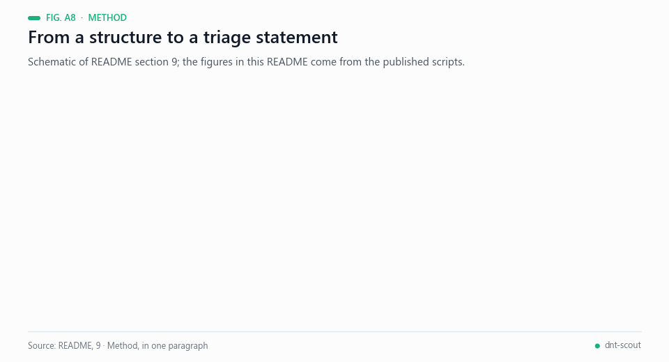<br><sub>Animated figure A8 — Schematic of the method paragraph below; it is not a data figure.</sub></p>

Structures are resolved from PubChem by CASRN/DSSTox identifier, standardised with RDKit (salts
stripped, charges neutralised, mixtures and inorganics flagged and excluded rather than coerced).
Representations are Morgan fingerprints (2048 bits, radius 2), MACCS keys and ten physicochemical
descriptors. Models are a prevalence control, L2 logistic regression on descriptors alone, a
similarity-weighted k-nearest-analogue read-across of the kind US EPA GenRA is built on, and a
random forest over the full feature matrix. Hyperparameters and the conformal calibration split are
chosen by grouped cross-validation **inside each training fold**; the test fold is touched once, to
predict. Confidence intervals resample whole scaffold groups, never individual chemicals. The
conformal quantiles and test scores come from the same fitted model. Formal coverage additionally
requires exchangeability; scaffold shift and domain filtering prevent an unconditional guarantee.

## 10 · Limitations

<p align="center">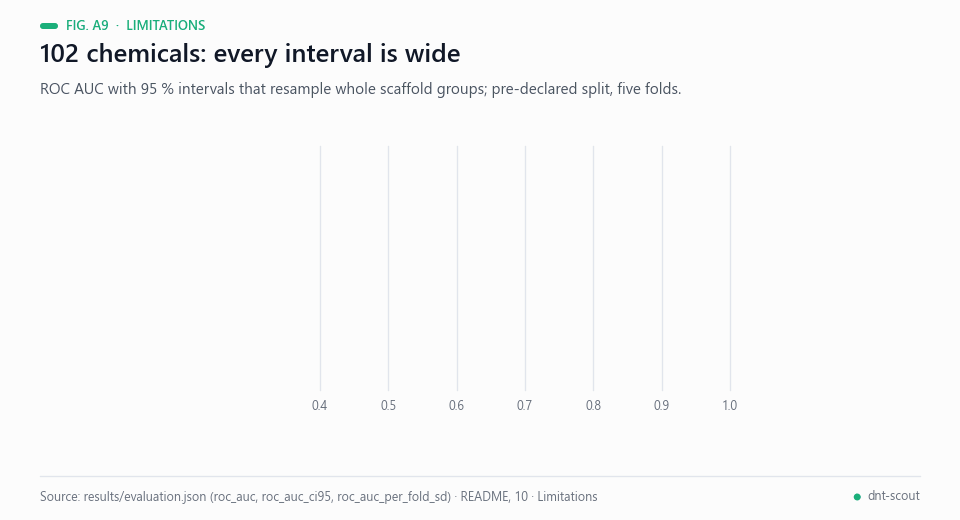<br><sub>Animated figure A9 — ROC AUC with 95 % intervals on the pre-declared split. Data: results/evaluation.json.</sub></p>

- **102 chemicals.** Every interval here is wide and the per-fold standard deviation of ROC is
  0.108. This is a small-data problem and is reported as one.
- **Cohort prevalence is 48%**, because the source cohort was enriched with suspected actives. The
  assay saving does not transfer unchanged to an unselected library.
- **Read-across's margin over the other models is split-dependent** (section 4).
- **Concordance, not external validation.** All 136 labelled chemicals are inside the wider EPA
  screen of 460, so the second dataset is a concordance check between cohorts, not an independent
  test set. It is reported as such.
- **One assay, one laboratory, one developmental window.** Network formation in rat cortical
  cultures is a model of a model.
- **Corrections verified 25 October.** Calibration and test now use the same fit-only similarity
  reference: 88/102 in-domain, with unchanged read-across scores. Core and portable scorer accept
  one organic fragment with inorganic counterions and reject multiple carbon-containing fragments;
  organic salts need an explicitly curated parent. The original SciencePal trace and film document
  the earlier version, and remain available as historical evidence.
- **API ablation is exploratory.** Reformulated B/B-prime arms were run after a failed original
  arm despite the no-retry rule. They are kept separate from confirmatory evidence and from the
  SciencePal run. Neither establishes a predictive improvement; see the audit update.

## Real-world applications

<p align="center">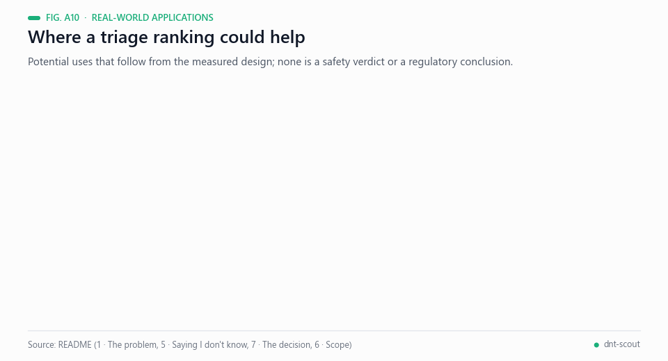<br><sub>Animated figure A10 — Potential uses of a triage ranking; none is a safety verdict or a regulatory conclusion.</sub></p>

These are potential uses that follow from what is measured above, not deployments. All of them inherit the limits of
section 10 and of the cohort the tool was evaluated on.

- **Ordering a microelectrode-array queue.** In the retrospective evaluation half of the selective compounds were
  found after 32 assays, against 51.5 for a random order. A laboratory with a long list of untested chemicals could
  use such a ranking to decide what to plate first; the saving on an unselected library is not measured here.
- **Scheduling in vitro assays.** Section 1 states that the US EPA plans to phase out mammalian testing; a ranking
  could help with the scheduling bottleneck it describes. This repository measures no animal-use outcome.
- **Saying what cannot be judged.** Chemicals without a resolvable structure or outside the applicability domain are
  reported as such, so a laboratory knows which ones need another route instead of receiving a guess.
- **Auditable shortlists.** Every score ships with its three nearest measured analogues and their outcomes
  ([`results/agent_package/scores.csv`](results/agent_package/scores.csv)), which lets a reviewer challenge a
  recommendation.
- **Agent-assisted triage.** The SciencePal run shows an agent resolving salts and adding literature support to the
  triage of 20 candidate chemicals; it is one run, and its accuracy was not measured.
- **A reporting pattern for small screens.** Grouped validation, an exact random baseline, a significance test that
  refits the pipeline and conformal abstention may be reusable for other small in vitro endpoints.

## Possible improvements

<p align="center">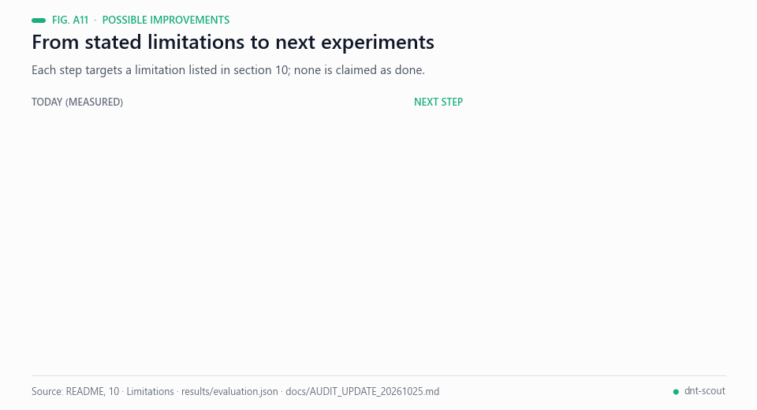<br><sub>Animated figure A11 — Each proposed step targets a limitation reported in section 10.</sub></p>

- **More chemicals, tighter intervals.** With 102 chemicals the per-fold standard deviation of the read-across ROC is 0.108 and every
  interval is wide (Animated figure A9). Labelling more of the wider EPA screen of 460, under a frozen protocol,
  is the most direct way to narrow them; it would not by itself make the second cohort an independent test set.
- **An unselected library.** The cohort prevalence is 48 % because suspected actives were enriched. Measuring the
  assay saving on an unselected chemical library would be a different experiment and the honest way to size the
  benefit.
- **A prospective plate.** The five recommended chemicals are a falsifiable prediction awaiting one plate
  ([`ABLATION.md`](results/sciencepal/ABLATION.md)); data from an independent laboratory would also address the
  "one assay, one laboratory, one developmental window" limit.
- **More decisive sets.** Conformal sets are uninformative for 63 % of chemicals and 13.7 % fall outside the
  applicability domain. Calibration and domain definitions could be tested on larger sets, keeping coverage and the
  right to abstain. Organic salts additionally need an explicitly curated parent structure under the declared policy.
- **Re-testing the agent claim.** The API ablation arms are exploratory and show no predictive improvement
  ([audit update](docs/AUDIT_UPDATE_20261025.md)); any new agent comparison should be pre-registered with a no-retry
  rule.

## Future work

<p align="center">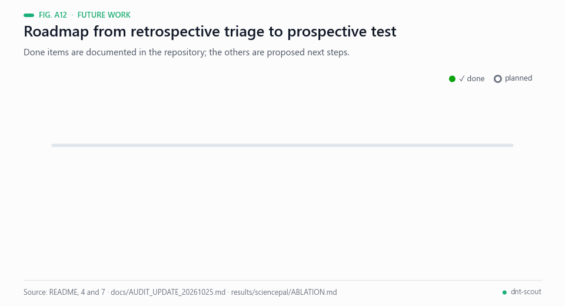<br><sub>Animated figure A12 — Completed milestones are documented in this repository; the rest are proposals.</sub></p>

Proposed next steps, in order; none is claimed as started:

1. Run the five recommended chemicals on a microelectrode-array plate and compare the outcome with the prediction.
2. Freeze a protocol and evaluate on an unselected chemical library to measure the real assay saving.
3. Add independent laboratory data, beyond one assay and one laboratory.
4. Extend labelling within the wider EPA screen and re-report every interval.
5. Test calibration and applicability-domain definitions on larger sets, and curate parent structures for common
   organic salts under the declared policy.

## Resource declaration

| | |
|---|---|
| **Created during the event** | All code in `src/` and `scripts/`, the outcome definition, every figure, every result, the agent package and this document. |
| **Prior work by the author** | Francisco Angulo de Lafuente works on computational neuroscience and has a separate, unrelated project (NeuroChip Twin) entered in another competition. **No code, model, preprocessing, text, figure or video from that work is used here.** DNT-Scout is a clean-room project: new question, new repository, new code, written from scratch. |
| **Third-party data** | US EPA network-formation assay, Shafer et al. 2019, ScienceHub DOI [10.23719/1503191](https://doi.org/10.23719/1503191) — US Government work, public domain. Structures from PubChem (public domain). Re-downloaded from source; SHA256 manifest in `docs/provenance.json`. |
| **Third-party software** | RDKit (BSD-3), scikit-learn (BSD-3), NumPy, pandas, Matplotlib. Ranking models use no pretrained weights; proprietary SciencePal/Anthropic LLMs and paid API ablations are declared separately. |
| **AI assistance** | Claude (Anthropic) was used as a programming and writing assistant throughout, under the author's direction. Numerical claims are checked against executed code; historical and corrected evaluations are kept separate in the audit update. |
| **Compute** | A single workstation and one Linux server with consumer GPUs. The models are small enough to train on a laptop; no GPU is required to reproduce anything here. |

## Citation and licence

Code is MIT-licensed (see [`LICENSE`](LICENSE)). The EPA data are public domain; if you use them,
cite Shafer et al. 2019 directly.

```
Angulo de Lafuente, F. (2026). DNT-Scout: structure-based triage for developmental
neurotoxicity screening, with calibrated abstention. https://github.com/Agnuxo1/dnt-scout
```

## Bibliography

1. <a id="ref-1"></a>Shafer, T. J., Brown, J. P., Lynch, B., et al. (2019). Evaluation of Chemical Effects on Network Formation in Cortical Neurons Grown on Microelectrode Arrays. *Toxicological Sciences*, 169(2), 436–455. https://doi.org/10.1093/toxsci/kfz052
2. <a id="ref-2"></a>Shafer, T. (2019). *Data for: Evaluation of Chemical Effects on Network Formation in Cortical Neurons Grown on Microelectrode Arrays*. U.S. EPA Office of Research and Development (ORD). https://doi.org/10.23719/1503191
3. <a id="ref-3"></a>Johnstone, A. F. M., Gross, G. W., Weiss, D. G., et al. (2010). Microelectrode arrays: A physiologically based neurotoxicity testing platform for the 21st century. *NeuroToxicology*, 31(4), 331–350. https://doi.org/10.1016/j.neuro.2010.04.001
4. <a id="ref-4"></a>OECD (2007). Test No. 426: Developmental Neurotoxicity Study. *OECD Guidelines for the Testing of Chemicals, Section 4*. https://doi.org/10.1787/9789264067394-en
5. <a id="ref-5"></a>Bemis, G. W., & Murcko, M. A. (1996). The Properties of Known Drugs. 1. Molecular Frameworks. *Journal of Medicinal Chemistry*, 39(15), 2887–2893. https://doi.org/10.1021/jm9602928
6. <a id="ref-6"></a>Butina, D. (1999). Unsupervised Data Base Clustering Based on Daylight's Fingerprint and Tanimoto Similarity: A Fast and Automated Way To Cluster Small and Large Data Sets. *Journal of Chemical Information and Computer Sciences*, 39(4), 747–750. https://doi.org/10.1021/ci9803381
7. <a id="ref-7"></a>Rogers, D., & Hahn, M. (2010). Extended-Connectivity Fingerprints. *Journal of Chemical Information and Modeling*, 50(5), 742–754. https://doi.org/10.1021/ci100050t
8. <a id="ref-8"></a>Durant, J. L., Leland, B. A., Henry, D. R., & Nourse, J. G. (2002). Reoptimization of MDL Keys for Use in Drug Discovery. *Journal of Chemical Information and Computer Sciences*, 42(6), 1273–1280. https://doi.org/10.1021/ci010132r
9. <a id="ref-9"></a>Helman, G., Shah, I., Williams, A. J., Edwards, J., Dunne, J., & Patlewicz, G. (2019). Generalized Read-Across (GenRA): A workflow implemented into the EPA CompTox Chemicals Dashboard. *ALTEX*, 36(3), 462–465. https://doi.org/10.14573/altex.1811292
10. <a id="ref-10"></a>Landrum, G. (n.d.). *RDKit: Open-source cheminformatics software*. https://www.rdkit.org/
11. <a id="ref-11"></a>Pedregosa, F., Varoquaux, G., Gramfort, A., et al. (2012). Scikit-learn: Machine Learning in Python. *arXiv* 1201.0490. https://arxiv.org/abs/1201.0490
12. <a id="ref-12"></a>Vovk, V., Gammerman, A., & Shafer, G. (2005). *Algorithmic Learning in a Random World*. Springer. https://doi.org/10.1007/b106715
13. <a id="ref-13"></a>Vovk, V. (2012). Conditional validity of inductive conformal predictors. *arXiv* 1209.2673. https://arxiv.org/abs/1209.2673
14. <a id="ref-14"></a>Angelopoulos, A. N., & Bates, S. (2021). A Gentle Introduction to Conformal Prediction and Distribution-Free Uncertainty Quantification. *arXiv* 2107.07511. https://arxiv.org/abs/2107.07511
15. <a id="ref-15"></a>Ojala, M., & Garriga, G. C. (2010). Permutation tests for studying classifier performance. *Journal of Machine Learning Research*, 11, 1833–1863. https://www.jmlr.org/papers/v11/ojala10a.html

---

<div align="center">
<sub>Built by <a href="https://github.com/Agnuxo1">Francisco Angulo de Lafuente</a> · every animated figure A1–A12
renders a published file named in its footer · <a href="#dnt-scout">back to top ↑</a></sub>
</div>
