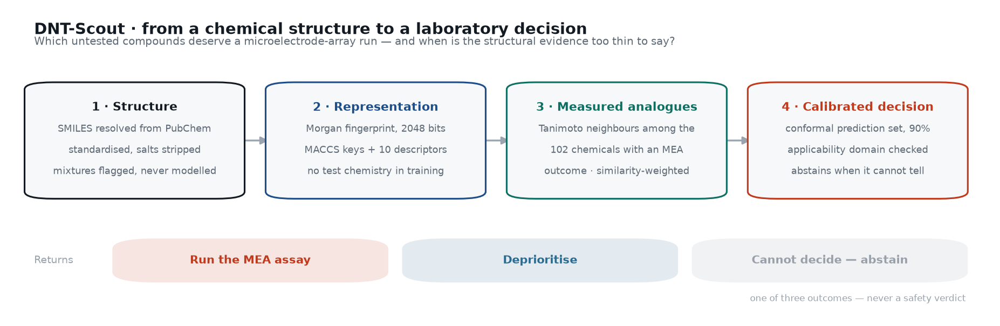
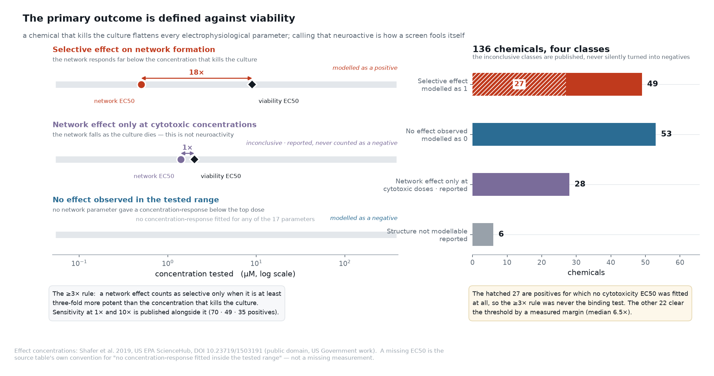
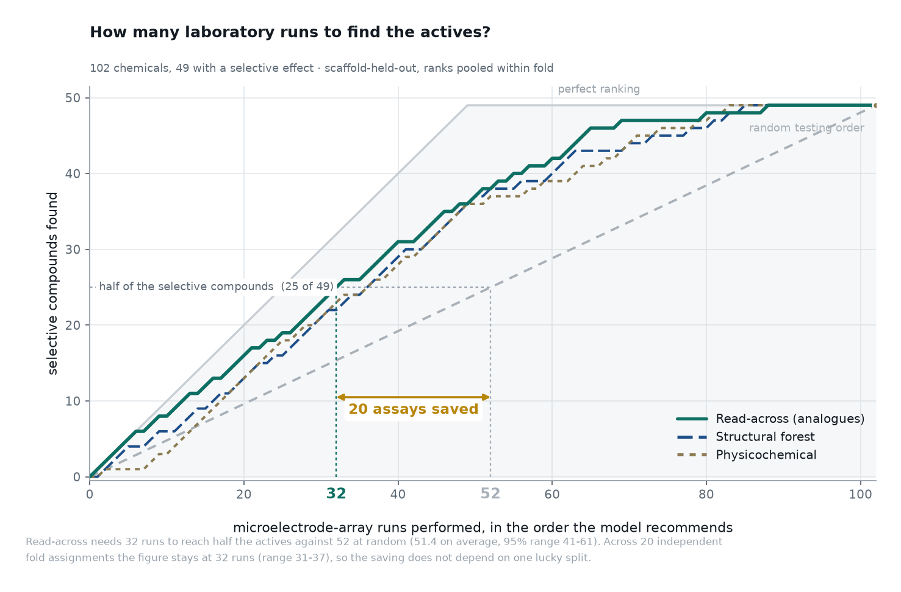
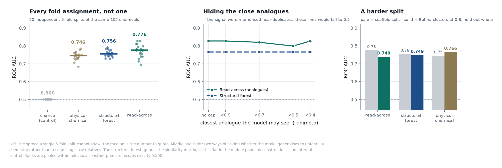
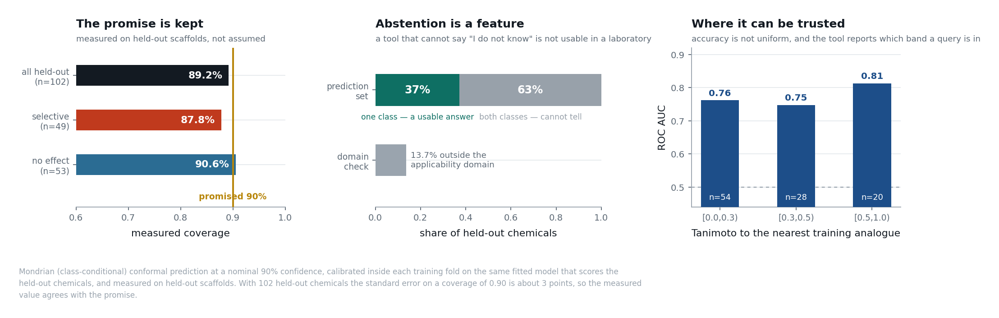
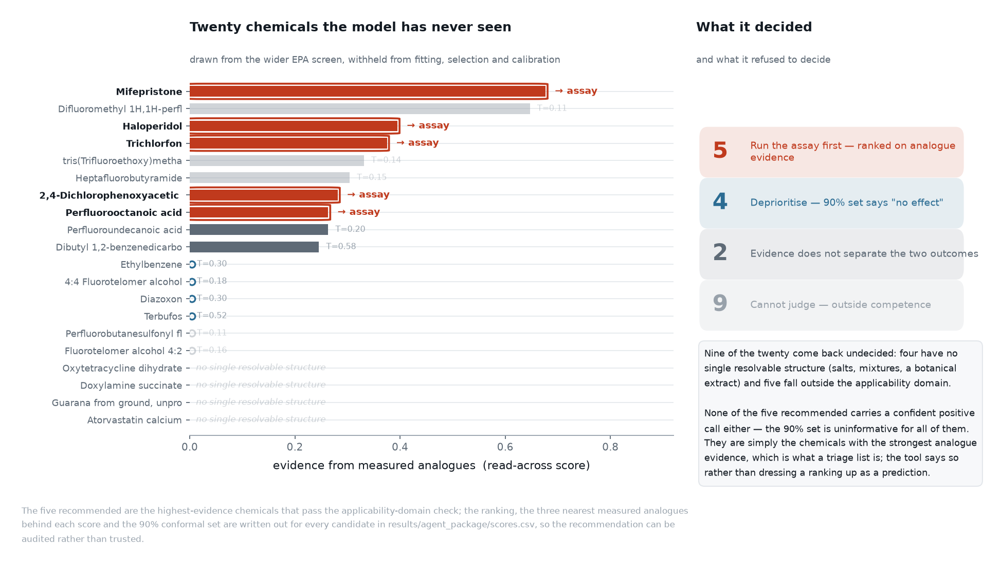
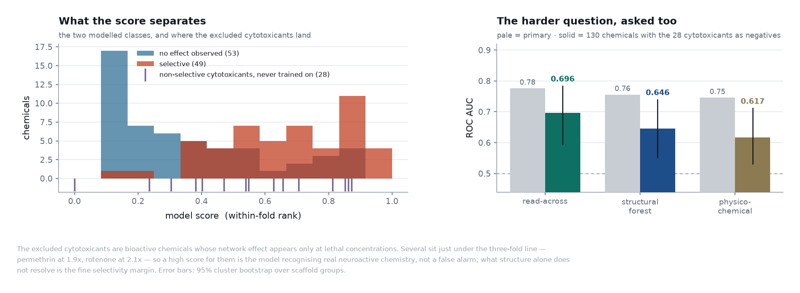

> Audit update 25 October: use AUDIT_UPDATE_20261025.md and the updated five-page PDF for corrected domain (88/102), salt policy and paid-API disclosure. The original demo and its numbers remain historical.

# DNT-Scout
### Structure-based triage for developmental neurotoxicity screening, with calibrated abstention

**2026 Global AI4Science Hackathon · Track: AI + Biology / AI Agent · Team: NeuroChip Twin (solo)**
Repository: https://github.com/Agnuxo1/dnt-scout (public, MIT) · SciencePal project: *see §5*

---

## 1 · The scientific question and why it is a real pain point

Developmental neurotoxicity (DNT) is one of the most expensive endpoints in regulatory toxicology
and one of the least covered. Tens of thousands of chemicals are in commerce; a few hundred have
been through a DNT battery. The *in vitro* alternative adopted by the OECD DNT-IVB guidance (2023)
— growing cortical neurons on a **microelectrode array (MEA)** and watching whether they organise
into a firing network — is far faster than an animal study, but still costs days of culture per
compound. With the US EPA moving to phase out mammalian testing, the binding constraint stops
being "is this chemical neurotoxic?" and becomes a scheduling problem:

> **Of the compounds nobody has tested, which ones go on the plate first — and when is the
> structural evidence too thin to say anything at all?**

That phrasing matters, because it makes the question *measurable*. The answer is not an accuracy
figure; it is **how many assays you have to run to find the actives**. Everything in this project
is validated against that number.

**The gap in the literature.** Strickland (2018) and Kosnik (2020) associate ToxPrint features with
MEA activity, but without a validated predictive model. Zhang (2021) and Morger (2021) apply
conformal prediction to Tox21, but to no neuronal endpoint. We found no published work that
predicts *selective* network-formation activity from structure alone with scaffold-held-out
validation **and** calibrated uncertainty **and** an explicit applicability domain. DNT-Scout does
those three together.

## 2 · Technical approach

**Data.** 136 chemicals with per-parameter EC50 values across 17 network parameters plus two
viability assays, from Shafer et al. 2019 (US EPA ScienceHub, DOI 10.23719/1503191; US Government
work, public domain), re-downloaded from source and pinned by SHA256. Structures resolved from
PubChem by CASRN/DSSTox identifier (132/136), standardised with RDKit: salts stripped, charges
neutralised, mixtures and inorganics **flagged and excluded rather than coerced**.

**The outcome, and the trap it avoids.** A chemical that kills the culture flattens every
electrophysiological parameter. Counting that as neuroactive is the main way a DNT screen fools
itself, so the primary outcome is **a selective effect**: at least one network parameter responds
at a concentration at least three-fold below any cytotoxic concentration. Ambiguous cases stay
visible as their own classes and are **never silently turned into negatives**.

| Class | n | Role |
|---|---|---|
| Selective effect on network formation | 49 | positive |
| No effect observed in the tested range | 53 | negative |
| Network effect only at cytotoxic concentrations | 28 | reported, excluded, analysed separately (§4) |
| Structure not modellable | 6 | reported, excluded |

Two things are stated openly rather than buried. The 3× threshold is a choice, so the class counts
at 1×, 3× and 10× are published together (70 · 49 · 35). And 27 of the 49 positives have **no
fitted cytotoxicity EC50 at all**, so for them the 3× rule was never the binding test — they are
"the network responded and nothing toxic was seen in range". The model finds both kinds about
equally well (ROC 0.854 for the 22 with a measured separation, 0.806 for the 27 without), so the
endpoint is one endpoint, not two in disguise.

**Models.** A prevalence control; L2 logistic regression on ten physicochemical descriptors; a
similarity-weighted k-nearest-analogue **read-across** of the kind US EPA GenRA is built on; and a
random forest over Morgan fingerprints + MACCS keys + descriptors. Hyperparameters and the
conformal calibration split are chosen by grouped cross-validation **inside each training fold**;
the test fold is touched once, to predict.

**Uncertainty.** Mondrian (class-conditional) conformal prediction at a nominal 90%, plus an
applicability-domain check on similarity to the nearest measured analogue. The conformal quantiles
and test scores come from the *same fitted model*. Formal coverage also requires exchangeability;
scaffold shift and domain filtering preclude an unconditional guarantee.

## 3 · Result

**Headline, stated two ways.** Testing in the order the model recommends, half the selective
compounds are found after **32 MEA runs** against **52** in a random order (51.4 on average, 95%
range 41–61) — about a third of the laboratory work removed. In accuracy terms, read-across reaches
**ROC AUC 0.776 (0.703–0.828)** as the median over 20 independent fold assignments. A perfect
oracle would need 25 runs, so the ranking captures about three quarters of the gain available at
all.

| Model | ROC AUC (pre-declared split) | ROC AUC (median of 20 splits) | PR AUC | Assays for half the actives |
|---|---|---|---|---|
| Chance (control) | **0.500** | 0.500 | 0.480 | 52 |
| Physicochemical descriptors | 0.750 | 0.746 | 0.635 | 36 |
| **Read-across from analogues** | **0.828** | **0.776 (0.703–0.828)** | **0.780** | **32 (31–37)** |
| Structural random forest | 0.766 | 0.756 | 0.674 | 36 |

The chance control landing at *exactly* 0.500 is not cosmetic — see §4.

## 4 · Validation, and four attempts to break the result

**A methodological defect we found and fixed.** Cross-validation produces one model per fold, and
nothing makes five models' probabilities comparable. Pooling raw scores into one ranking mixes five
scales: our prevalence baseline — a constant per fold, which *must* score chance — came out at ROC
0.473, and every ranking metric inherited the bias. Converting each score to its rank *within its
own fold* puts the control at exactly 0.500 and raises read-across from 0.803 to 0.828. Both
numbers are published side by side and a regression test prevents the raw version returning. We
also found and fixed a conformal procedure calibrated on a different model from the one making the
predictions, and an operating threshold taken from the evaluation set's own labels.

**Is it memorising close relatives?** Read-across votes on measured analogues, so this is the
obvious worry. Hiding every training analogue above a similarity cap answers it: at a cap of 0.7,
ROC 0.820; at 0.5, ROC 0.799. There was little to memorise anyway — the median nearest-analogue
Tanimoto across the set is 0.36 and only 4% of chemicals have an analogue above 0.9. The structural
forest ignores the similarity matrix and is flat across the cap: the internal control this test
needs.

**A harder split.** 72% of Bemis-Murcko scaffold groups hold a single chemical, so scaffold-held-out
is close to leave-one-out. Holding out whole Butina clusters at 0.6 similarity drops performance to
0.74–0.77 — still far above chance, but the three model families converge. **Read-across being the
best model is specific to the scaffold split; structure carrying real signal is not.** We say so.

**Calibration is measured, not claimed.** Coverage on held-out scaffolds is 89.2% against the 90%
promised (87.8% / 90.6% by class). With 102 held-out chemicals the standard error on a coverage of
0.90 is about 3 points, so these agree. The honest cost: the prediction set is uninformative for
63% of chemicals and 7.8% fall outside the applicability domain. Those are the queries where the
right answer is a shrug, and the tool gives one.

## 5 · SciencePal in the core step

<!-- FILLED IN AFTER EXECUTION -->
*SciencePal project link:* https://sciencepal.ai/share/248df9d7-b3aa-4607-8e4c-c4de1a9abc5e

The central decision of this project does not happen in our repository — it happens inside
SciencePal. The platform's Biology Agent is given `agent_package/`: the 102 measured analogues with
their outcomes, 20 chemicals from the wider EPA screen withheld from every stage of fitting,
selection and calibration, and a task specification. Inside the SciencePal sandbox the agent
resolves each candidate to a structure, computes fingerprints and analogue similarities with RDKit,
applies the exported model and conformal quantiles, consults the literature on the nearest
analogues, and returns a structured triage report: five chemicals to assay, with evidence,
uncertainty, reason, and the next assay to run.

**Pre-declared ablation (E9):** automatic ranking alone versus ranking + agent, scored on the same
20 withheld chemicals, so the platform's contribution is measured rather than asserted.

Nine of the twenty come back **undecided** — four have no single resolvable structure, five are
outside the applicability domain — and none of the five recommended carries a confident positive
call either. They are the chemicals with the strongest analogue evidence, which is what a triage
list is, and the tool reports it that way rather than dressing a ranking up as a prediction.

## 6 · Limitations

- **102 chemicals.** Every interval is wide; the per-fold standard deviation of ROC is 0.108.
- **Cohort prevalence is 48%** because the EPA enriched it with suspected actives. The assay saving
  does not transfer unchanged to an unselected library, and we do not claim it does.
- **The excluded cytotoxicants.** The 28 non-selective cytotoxicants carry 22 scaffolds that then
  appear nowhere in the modelled set, and they form a coherent mechanistic family. On the harder
  endpoint — selective versus *everything else* — read-across scores 0.696 (0.595–0.784), 44 assays
  against 65.5. The model does rank several of them highly, which is worth reading carefully:
  permethrin sits at 1.9×, rotenone at 2.1×, just under the three-fold line, so a high score is the
  model recognising real neuroactive chemistry; what structure alone does not resolve is the fine
  selectivity margin. In the EPA protocol viability is read from the same plate, so such an assay
  still returns a usable answer.
- **Concordance, not external validation.** All 136 labelled chemicals sit inside the wider EPA
  screen of 460, so the second dataset is a cohort concordance check, not an independent test set.
- **Not a safety verdict.** A negative *in vitro* result does not exclude developmental
  neurotoxicity; the OECD guidance says so directly. This is a laboratory scheduling tool.

## 7 · Next steps

1. **Extend to the 324 chemicals of the wider screen** that have network data but no viability
   measurement — a weaker label, requiring an explicit statement of why, and a natural test of
   whether the ranking survives a noisier outcome.
2. **Prospective validation.** The five recommendations in §5 are a falsifiable prediction. Running
   them on an MEA plate would settle the matter in one experiment.
3. **A pre-declared graph-neural-network comparison**, deliberately left out of this sprint at 102
   chemicals, once there is enough data to make it meaningful.
4. **Cross-laboratory concordance** between the NTP and ToxCast cohorts within the EPA screen.

## Originality and resource declaration

| | |
|---|---|
| **New, created during the event** | All code in `src/` and `scripts/`, the outcome definition, every figure, every result, the agent package, this document. |
| **Prior work by the author** | The author has a separate, unrelated project (NeuroChip Twin) entered in another competition. **No code, model, preprocessing, text, figure or video from it is used here.** DNT-Scout is a clean-room project: new scientific question, new repository, new code from scratch. Declared for transparency, not reused. |
| **Third-party data** | US EPA network-formation assay, Shafer et al. 2019, DOI 10.23719/1503191 (US Government work, public domain). PubChem structures (public domain). Re-downloaded from source; SHA256 manifest in `docs/provenance.json`. Raw data are not redistributed. |
| **Third-party software** | RDKit (BSD-3), scikit-learn (BSD-3), NumPy, pandas, Matplotlib. No proprietary models, no paid APIs, no pretrained weights. |
| **AI assistance** | Claude (Anthropic) used as a programming and writing assistant under the author's direction. Every scientific claim was checked against executed code; every number in this document is produced by a script in the public repository. |
| **Team contribution** | Solo entry. Francisco Angulo de Lafuente: scientific question, design, implementation, analysis, writing. |
| **Compute** | One workstation and one Linux server with consumer GPUs. No GPU is required to reproduce any result here. |

**Reproducibility.** `pip install -e .` then four scripts regenerate every number and figure in this
document; `pytest` runs 21 tests, four of which exist specifically to stop the defects described in
§4 from coming back.
